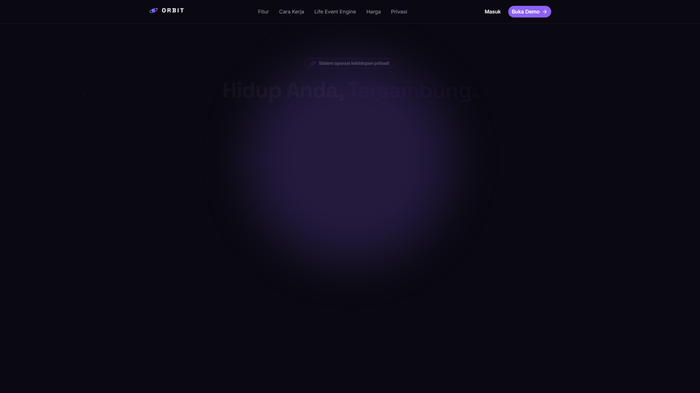
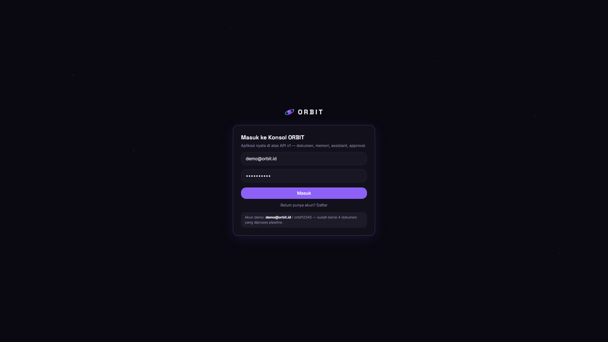

# ORBIT — Personal Life Operating System

> Hidup Anda, tersambung. Jawaban AI berbasis data tersimpan Anda, semua aksi otomatis butuh persetujuan, data tidak pernah dijual.

Struktur repo:

| Folder | Isi |
|---|---|
| `app/` | Konsol web (React 19 + Vite 7 + Tailwind v4) + backend API v1 (Node, tanpa dependensi: `node:http` + `node:sqlite`) + PWA |
| `mobile/` | Aplikasi mobile (Expo SDK 58 + expo-router) — Home/Inbox/Capture/Timeline/Assistant |
| `blueprint/` | Dokumen acuan produk & engineering (ORBIT_Blueprint_v1 + review v1.1) |
| `docs/operasional/` | Draf kebijakan beta (privasi, ToS, retensi, insiden) — perlu review pemilik |
| `.github/workflows/` | CI: lint · typecheck · test e2e · build |

## Fitur Aplikasi

**ORBIT** adalah Personal Life Operating System yang menggabungkan manajemen dokumen, asisten AI, dan life management dalam satu platform:

- **Manajemen Dokumen** — Upload, klasifikasi, dan ekstraksi data dari dokumen dengan pipeline otomatis
- **Hybrid Search** — Pencarian cerdas menggunakan keyword + vector embedding
- **Asisten AI (RAG)** — Jawaban AI berbasis data tersimpan dengan sitasi sumber
- **Approval Workflow** — Semua aksi otomatis memerlukan persetujuan pengguna
- **Tasks & Reminders** — Manajemen tugas dan pengingat dengan scheduler otomatis
- **Dashboard** — Agregat data dan metrik penggunaan
- **Life Event Engine** — Buat rencana dari satu kalimat (move, travel, wedding, dll)
- **Auth & Security** — Autentikasi aman dengan session management dan workspace isolation
- **Mobile App** — Aplikasi mobile (Expo) dengan Home, Inbox, Capture, Timeline, Assistant
- **Freemium** — Sistem paket Free/Plus dengan kuota dan usage tracking
- **Backup & Export** — Backup database otomatis dan export data ke JSON





## Menjalankan (lokal)

```bash
# backend + frontend (single-process, port 8787)
cd app
cp .env.example .env   # bila ada; isi OPENAI_* / GEMINI_API_KEY (opsional — lokal deterministik selalu jangkar)
node server/index.mjs
npx vite preview --port 4173   # konsol web; atau buka http://localhost:8787 langsung (dist sudah disajikan server)

# mobile (Expo)
cd mobile
npm start             # Expo dev server; EXPO_PUBLIC_API_URL di .env.example
```

Akun demo: `demo@orbit.id` / `orbit12345`

## Uji & metrik

```bash
cd app
npm test        # 20 test e2e (checklist beta docs/08) — DB terisolasi, AI lokal
npm run test:load   # load test endpoint kritis
npm run metrics     # metrik validasi pasar (docs/06)
node server/backup.mjs   # backup + verifikasi restore (juga otomatis harian)
```

## Konfigurasi (opsional)

Semua via `app/.env` (di-gitignore): `OPENAI_BASE_URL`, `OPENAI_API_KEY`,
`OPENAI_UA`, `GEMINI_API_KEY`, `AI_PROVIDER` (openai-responses|gemini|local),
`AI_COOLDOWN_MS`, `MIDTRANS_SERVER_KEY` + `MIDTRANS_ENV` (gateway pembayaran —
tanpa kunci → mode mock), `CORS_ORIGIN`, `SENTRY_DSN` (error tracking — tanpa
DSN: no-op). Mobile: `EXPO_PUBLIC_API_URL`.

**Lapisan data** (`ORBIT_DB`): default **SQLite** (nol konfigurasi);
`ORBIT_DB=pglite` → PostgreSQL embedded untuk uji lokal (skema bootstrap
otomatis dari blueprint); `ORBIT_DB=pg` + `DATABASE_URL` → Supabase/Postgres
produksi. Migrasi skema+data: lihat `docs/supabase-migrasi.md`
(`npm run export:pg` + `npm run verify:pg`).

Status & sisa pekerjaan produksi (Supabase, Sentry, publikasi legal) — lihat
`blueprint/ORBIT_Blueprint_v1/docs/08-beta-checklist.md` dan catatan sesi.
